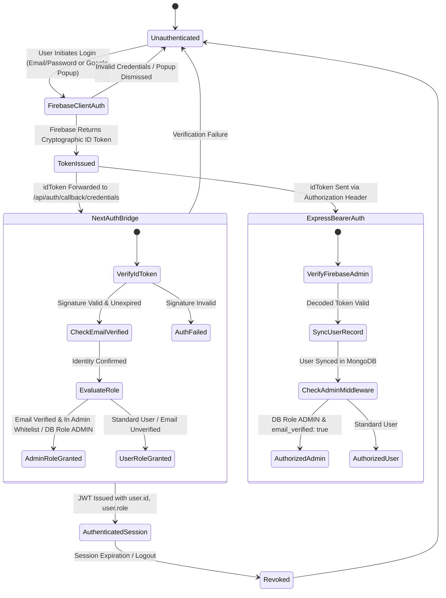

# Formal Authentication State Machine & Account Linking Model

**System**: Otakuverse Identity Subsystem  
**Components**: Firebase Auth, Google OAuth 2.0 / OIDC, NextAuth JWT Sessions, Express Auth Middleware, MongoDB User Store

---

## 1. Authentication State Machine Diagram

---

## 2. Formal Transition Table

| Transition ID | Initial State | Trigger / Event | Preconditions | Authorized Actor | Next State | Side Effects | Failure Behavior |
| :--- | :--- | :--- | :--- | :--- | :--- | :--- | :--- |
| **TR-01** | `Unauthenticated` | `EMAIL_PASS_LOGIN` | Valid format email & password | Any Public User | `TokenIssued` | Firebase issues signed ID token | Return 401 with standard error |
| **TR-02** | `Unauthenticated` | `GOOGLE_OAUTH_POPUP` | Google OAuth code flow | Any Google User | `TokenIssued` | Google signs ID token with verified email | User dismissed or Google error |
| **TR-03** | `TokenIssued` | `NEXTAUTH_SIGNIN` | Valid `idToken` payload passed to NextAuth | Authenticated Firebase User | `AuthenticatedSession` | Issues secure HTTP-only NextAuth JWT cookie | Return null / 401 Unauthorized |
| **TR-04** | `TokenIssued` | `EXPRESS_API_CALL` | `Authorization: Bearer <token>` header present | API Consumer | `AuthorizedUser` | Sets `req.user = decodedToken` | Return 401 `AUTH_UNAUTHORIZED` |
| **TR-05** | `AuthorizedUser` | `ACCESS_ADMIN_ROUTE` | Route protected by `authorizeAdmin` | Caller with Admin Claims | `AuthorizedAdmin` | Proceeds to controller | Return 403 `FORBIDDEN` |
| **TR-06** | `AuthenticatedSession` | `LOGOUT` | User clicks Sign Out | Session Owner | `Unauthenticated` | Clears cookies and session store | Session destroyed |

---

## 3. Account Linking & Identity Invariants

### 1. The Verified Email Invariant
Under no circumstances may an unverified identity link to an existing verified account. If User A creates a Firebase account using `victim@example.com` without verifying email ownership, the identity sync engine rejects account linking and creates a distinct unverified identity record.

### 2. Provider ID Immutability
User accounts in MongoDB are keyed by `authProviderId: decodedToken.uid`. This prevents identity confusion if an email address is modified in the identity provider.

### 3. Role Assignment Security
Self-registration payloads containing `{ role: 'ADMIN' }` are stripped. Only users whose Firebase ID token asserts `email_verified: true` AND whose email is present in the server's `ADMIN_EMAILS` environment variable can be assigned or retain the `ADMIN` role.
