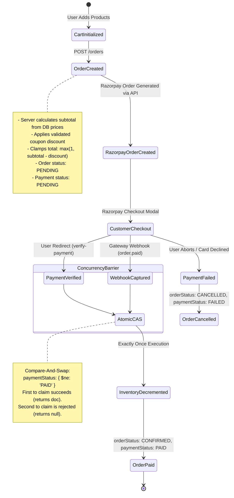

# Payment Integrity, Webhook Verification & Order Invariants

**System**: Otakuverse Checkout & Payment Engine  
**Payment Gateway**: Razorpay Payments Infrastructure  
**Core Invariant**: No financial or inventory mutation may occur without authenticated, cryptographically verified payment evidence.

---

## 1. The E-Commerce Financial Lifecycle



---

## 2. Core Financial Invariants

### Invariant 1: Server-Authoritative Pricing
- The client cannot propose, override, or modify unit prices or discounts.
- All product prices are resolved by MongoDB query on the product ID.
- Coupons are validated server-side against expiration dates, minimum purchase amounts, and usage limits.
- Order total is strictly non-negative:
  $$\text{Total} = \max(1, \text{Subtotal} + \text{Shipping} + \text{Tax} - \text{ValidDiscount})$$

### Invariant 2: Cryptographic Signature Verification
Payment confirmation requires valid HMAC-SHA256 verification:
$$\text{HMAC-SHA256}(\text{keySecret}, \text{razorpayOrderId} + "|" + \text{razorpayPaymentId}) \equiv \text{razorpaySignature}$$
Calculations use constant-time comparison (`crypto.timingSafeEqual`) to prevent timing side-channel attacks.

### Invariant 3: Order Substitution Prevention
Verification queries the database strictly by `razorpayOrderId`. The system asserts that `order.orderNumber === clientOrderNumber` and that the paid amount matches the order total.

### Invariant 4: Webhook Authenticity & Raw Body Integrity
Webhook events require an `x-razorpay-signature` header verified against the unparsed raw request bytes captured via `express.json({ verify: ... })`. Tampered or missing signatures return HTTP 400 immediately.

### Invariant 5: Idempotency & Concurrency Controls
Payment verification and webhook delivery occur concurrently. To prevent double inventory decrements, state transitions use atomic Compare-And-Swap (CAS):
```typescript
const claimed = await ordersCollection.findOneAndUpdate(
  {
    orderNumber,
    'payment.paymentStatus': { $ne: 'PAID' },
  },
  {
    $set: {
      'payment.paymentStatus': 'PAID',
      'payment.paidAt': new Date(),
      orderStatus: 'CONFIRMED',
    },
  }
);
```
Only the transaction that successfully mutates `paymentStatus` from `PENDING` to `PAID` triggers `decrementProductStock`. Duplicate executions are safely deduplicated.

### Invariant 6: Inventory Consistency
Inventory decrement operations use atomic `$inc: { stock: -quantity }` with `{ stock: { $gte: quantity } }` guards to prevent negative inventory balances under concurrent customer checkouts.
