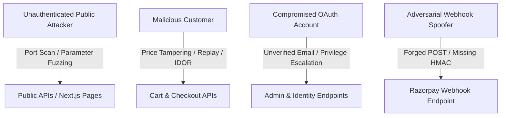
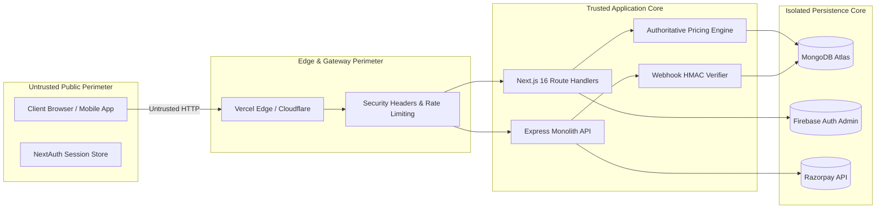

# Comprehensive Threat Model

**System**: Otakuverse E-Commerce Architecture  
**Methodology**: STRIDE / OWASP Top 10 / OWASP ASVS  
**Scope**: Full Stack (Next.js 16 Web/API, Express Monolith, MongoDB Atlas, Razorpay, Firebase Authentication)

---

## 1. Protected Assets & Value Classification

| Asset | Sensitivity | Invariants & Security Objectives |
| :--- | :--- | :--- |
| **Financial Ledgers & Orders** | High / Critical | Order subtotal, shipping, and discount calculations must be server-authoritative; orders cannot transition to `PAID` without authentic cryptographic proof. |
| **Payment Gateway Credentials** | Critical | Razorpay Key Secret and Webhook Secret must remain confined to backend environments and never be exposed to clients. |
| **Admin Authorization Boundary** | Critical | Only verified staff accounts with `email_verified: true` and explicit database/custom claim `ADMIN` roles may access administrative controls. |
| **Product Inventory & Catalog** | High | Stock numbers must decrement atomically upon verified payment; catalog prices cannot be modified by unauthenticated users. |
| **Customer Personally Identifiable Information (PII)** | High | Shipping addresses, names, emails, and phone numbers must be strictly isolated to the owning tenant (`firebaseUid`). |

---

## 2. Adversary Personas & Threat Capabilities

1. **Unauthenticated Public Attacker**: Attempts credential stuffing, IDOR on public REST endpoints, ReDoS against catalog search, and brute force of administrative paths.
2. **Malicious Customer**: Authenticated as a standard user. Attempts to tamper with price parameters, inject client discounts, reuse coupons, substitute payment signatures, and exfiltrate third-party addresses.
3. **Compromised / Rogue Identity**: Registers arbitrary Firebase accounts with unverified admin email aliases in an attempt to trick authorization gates into granting administrative authority.
4. **Adversarial Webhook Spoofer**: Sends forged HTTP POST notifications to payment webhook endpoints to trigger unauthorized fulfillment of unpaid orders.

---

## 3. Perimeter & Trust Boundary Architecture

### Trust Boundary Invariants
1. **Boundary 1 (Client → Gateway)**: Everything received over HTTP (`req.body`, `headers`, `cookies`, `query`) is untrusted. Client-provided prices, roles, discounts, and payment statuses are rejected.
2. **Boundary 2 (Application → Database)**: All database queries must include tenant isolation clauses (`firebaseUid: user.uid`). All updates must be atomic.
3. **Boundary 3 (External Provider → Webhook)**: Webhook requests are untrusted until verified using cryptographic HMAC-SHA256 signatures against exact raw bytes.

---

## 4. STRIDE Threat Mapping

| Threat Category | Potential Attack Vector | Applied Mitigation & Architectural Defense |
| :--- | :--- | :--- |
| **Spoofing** | Forged user identity or admin impersonation via unverified email. | Cryptographic Firebase ID Token verification with mandatory `email_verified: true` check. |
| **Tampering** | Altering price, quantity, or discount fields in checkout payload. | Authoritative server pricing engine. Explicit 400 Bad Request rejection of client discounts. |
| **Repudiation** | Claiming an order was paid when gateway did not capture funds. | Gateway cryptographic signature check (`razorpay_signature`) and raw HMAC webhook validation. |
| **Information Disclosure** | Address IDOR leaking other customers' phone numbers and street addresses. | Scoped atomic `findOneAndUpdate({ _id, firebaseUid })`. |
| **Denial of Service** | Catastrophic backtracking ReDoS via regex catalog search parameters. | `sanitizeString` escapes all regex metacharacters `[.*+?^${}()|[\]\\]` and caps search length. |
| **Elevation of Privilege** | Self-service promotion to `ADMIN` in profile updates or user sync. | Strict field allowlists; server-controlled role assignment pinned to verified Firebase UID. |
